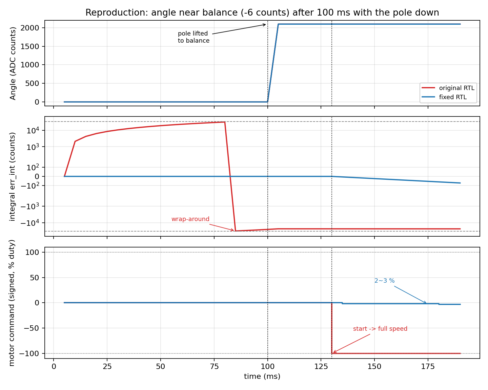

# 倒立摆“平衡点附近高速失控”问题分析与修复

> 工程：`D:\project\fpga\Gowin\pendulum`（GW2A-LV18PG256CC8/I7）
> 结论先说：**不是调参问题，是 `pid_core` 的积分在 32 位 16.16 下溢出回绕，而且停机时
> 还在继续积分**。摆倒下约 80 ms 积分就溢出，输出被顶到 ±100%；再按 K1 启动，
> 电机就是满占空比。已修复并用 RTL 仿真复现 / 验证。

---

## 1. 复现（RTL 仿真，不是估算）

测试平台 `sim/tb_top.v`，直接仿真实工程 RTL：

1. `0 ~ 100 ms`：摆垂下（`Angle = 0`），`RunState = 0`，不按任何键；
2. `100 ms`：把摆扶到平衡点附近（`Angle = 2096`，相对中心只偏 **6 个码值**）；
3. `105 ms`：按下 K1（消抖 20 ms），`130 ms` 闭环启动；
4. 观察 `angle_pid_out` / `pwm_duty` / `in1,in2`。

| 时刻 | 旧版 `err_int`（16.16 原值） | 旧版输出 | 修复版 `err_int` | 修复版输出 |
|---|---|---|---|---|
| 10 ms | 136,839,168（2088 counts） | +100 | 0 | 0 |
| 80 ms | 2,052,587,520（31,320 counts） | +100 | 0 | 0 |
| 85 ms | **-2,105,540,608（回绕）** | +100 | 0 | 0 |
| 130 ms（启动） | -1,560,805,376 | **-100 → 占空比 100%** | 0 | 0 |
| 135 ms | -1,561,329,664 | -100 → 100% | -393,216（-6） | **-2 → 2%** |
| 190 ms | -1,567,096,832 | -100 → 100% | -4,718,592（-72） | **-3 → 3%** |

同一激励下：**旧版一启动就是 -100%（满速），修复版是 -2%~-3%（正常的小修正）**。



复现命令（PowerShell，在工程根目录）：

```powershell
# 旧版（backup 里是原始文件）
iverilog -o sim/tb_orig.vvp -s tb_top sim/tb_top.v src/PWM.v src/adc.v `
  src/encoder.v src/key_filter.v backup/pid_core.v.orig backup/top.v.orig `
  src/uart.v src/uart_tx.v
vvp sim/tb_orig.vvp

# 修复版
iverilog -o sim/tb_fix.vvp -s tb_top sim/tb_top.v src/PWM.v src/adc.v `
  src/encoder.v src/key_filter.v src/pid_core.v src/top.v src/uart.v src/uart_tx.v
vvp sim/tb_fix.vvp
```

另外 `sim/tb_pid.v` 单独测了积分限幅：误差 2088 连续 50 次更新，积分停在
500 counts（32,768,000），输出 4%；`run=0` 后立即归零；重新启动不携带旧积分。

---

## 2. 根因

### 2.1 主因：角度环积分 32 位 16.16 溢出，且没有任何限幅

旧版 `src/pid_core.v`：

```verilog
reg signed [31:0] error_int;                       // 16.16
wire signed [31:0] error_int_next = (Ki != 0) ? (error_int + error0_fixed) : 0;
...
error_int <= error_int_next;                       // 没有限幅、没有抗饱和
```

- 16.16 定点里 `error0_fixed = error << 16`，1 个码值误差 = 65536；
- 32 位有符号能表示的整数范围只有 ±32768，所以积分最多只能累计 **32768 个码值**的误差；
- 摆倒下时误差约 2088 码值，每次更新 +136,839,168，
  `2^31 / 136,839,168 ≈ 15.7` → **约 16 次 × 5 ms = 80 ms 就溢出**；
- 溢出后寄存器从 +2.05e9 直接变成 -2.10e9，符号翻转；
  `Ki × error_int` 立刻把输出顶到 **-100%**，而且要把积分“拉回来”
  需要 32768 码值的反向误差，实际上要很久；
- 结果是：输出在 ±100% 之间来回翻，电机全速正反打。

这不是“增益太大”，是**数值表示不够 + 没有限幅**。

### 2.2 停机时 PID 仍在积分（两个环都有）

旧版 `top.v`：

```verilog
assign update_angle = tick_1ms && (cnt_5ms == 5'd4);   // 只看时基
assign update_loc   = tick_1ms && (cnt_50ms == 5'd49);
```

`RunState` 只用于 `motor_out = RunState ? angle_pid_out : 0`，**PID 本身照常每 5 ms /
18 ms 更新一次**。所以：

- 摆垂下 / 手扶 / 倒下自动停机期间，角度环一直在积分；
- 位置环也一直在积分：上电时 `pos = 32768`、`Location = pos - 32768`，
  只要小车不在“上电零点”，位置误差就会让积分慢慢涨起来；以 1000 码值偏差为例，
  约 `32 × 18 ms ≈ 0.6 s` 就会溢出，然后输出一个满幅的角度目标偏移；
- 用户把摆扶正、按 K1 的瞬间，两个积分早已饱和 → **满占空比**。

**“总是在平衡位置附近失控”就是因为：平衡位置正是你按键启动的位置。**

### 2.3 死区 4 码值 + `MIN_DUTY = 8%` 构成继电特性

```verilog
localparam MIN_DUTY = 8'd8;
wire [7:0] pwm_duty = (motor_out_abs == 0) ? 0 :
                   (motor_out_abs < MIN_DUTY) ? MIN_DUTY : motor_out_abs;
```

- `|error| <= 4` 时输出强制 0（刹车）；
- 一旦出死区，输出至少 8%；
- 角度环 `Kp = 0.25`，要做到 8% 需要 32 个码值误差。

所以在 ±4 ~ ±32 码值这段里，控制量只有“0% 或 8%”两种状态，
是一个带死区的继电控制。再加上角度环阻尼很弱（见 2.5），
平衡点附近会出现**越振越大**的极限环，最后也表现为高速来回冲。

### 2.4 位置环实际是 18 ms 一次，不是 50 ms

```verilog
reg [5:0] cnt_50ms;
cnt_50ms <= (cnt_50ms == 5'd49) ? 0 : cnt_50ms + 1;   // 5'd49 只有 5 位
assign update_loc = tick_1ms && (cnt_50ms == 5'd49);
```

`49 = 6'b110001`，需要 6 位；`5'd49` 被截断成 `5'd17`。
综合日志里也有这两条：

```
WARN (EX3792): Literal value 'd49 truncated to fit in 5 bits (top.v:154)
WARN (EX3792): Literal value 'd49 truncated to fit in 5 bits (top.v:158)
```

于是位置环每 **18 ms** 跑一次（55 Hz），不是设计的 50 ms。这会让
`Kd_pos` 的等效微分增益变成设计值的 2.8 倍，外环比预期激进得多。

### 2.5 微分滤波端口没接

`pid_core` 有 `diff_lpf_shift`，但 `top.v` 两个例化都没连：

```
WARN (EX3073): Port 'diff_lpf_shift' remains unconnected (top.v:130)
WARN (EX2565): Input 'diff_lpf_shift[4:0]' ... Assigning to 0
```

硬件上等效为“不滤波”。另外按当前 5 ms 周期，`Kd = 0.41` 换算成连续微分时间
只有 `Kd × T / Kp = 0.41 × 0.005 / 0.25 ≈ 8 ms`，相对摆的时间常数（对半米左右的摆约 0.16 s）
阻尼非常弱——这也是平衡点附近容易振荡的原因之一。

### 2.6 位置环启动瞬间目标固定为 0、权限 ±100 码值

- `LocationTarget` 固定为 0（上电零点）。如果上电时小车不在零点，一启动外环
  就要求“回到 0”，直接给一个很大的倾斜目标；
- 位置环输出直接就是角度目标偏移，最大 ±100 码值，权限过大。

---

## 3. 已做的修改

| 文件 | 修改 |
|---|---|
| `src/pid_core.v` | 新增 `run`（停机清零）、`int_max`（积分限幅）；启动沿预置 `error1_fixed` 消除微分冲击；输出饱和时停止积分（条件积分）；`diff_lpf_shift` 真正生效 |
| `src/top.v` | PID 传 `run(RunState)`；两个环分别设 `int_max`；接上 `diff_lpf_shift=1`；修 `6'd49`；位置环输出限幅 ±60；启动时把当前位置锁为位置环目标；删掉 `MIN_DUTY` 硬性 8%；删掉重复的 `in1/in2` assign；中心角统一为 2090 |
| `backup/` | 原始 `pid_core.v`、`top.v` 备份 |
| `sim/` | 复现用 testbench、日志、对比图、绘图脚本 |

关键代码（`pid_core.v`）：

```verilog
// 积分限幅：int_max 单位是误差码值
wire signed [32:0] int_acc = {error_int[31], error_int} + {error0_fixed[31], error0_fixed};
wire signed [32:0] int_lim = {int_max[15], int_max, 16'd0};
wire signed [31:0] int_clamped = (int_acc >  int_lim) ?  int_lim[31:0] :
                                 (int_acc < -int_lim) ? -int_lim[31:0] : int_acc[31:0];

// 输出已饱和且误差同向 -> 不再积分
wire int_hold = ((out >= 8'sd100) && (error0_fixed > 0)) ||
                ((out <= -8'sd100) && (error0_fixed < 0));
wire signed [31:0] int_next = int_hold ? error_int : int_clamped;

always @(posedge clk or negedge rst_n) begin
    if (!rst_n || !run) begin           // 停机彻底清零
        error1_fixed <= 0; error_int <= 0; diff_filtered <= 0; out <= 0;
    end else if (run_rise) begin         // 启动无微分冲击
        error1_fixed <= error0_fixed; error_int <= 0; diff_filtered <= 0; out <= 0;
    end else if (update) ...
end
```

角度环取 `int_max = 500`：`Ki = 0.01` 时积分最多贡献 5%，再也不会出现满幅偏置。
位置环 `int_max = 1000`，输出再限幅 ±60 码值。

位置环增益已按“保持 18 ms 版本的等效增益”折算到 50 ms：

```
Ki_50ms = 0.01  × 50/18 ≈ 0.028
Kd_50ms = 4.56  × 18/50 ≈ 1.64
```

---

## 4. 上机调试步骤（重要）

1. **先保安全**：电源限流；小车左右加软限位；手边随时能按 K1（K1 是启停）。
2. 用 Gowin IDE 重新综合、布局布线、下载（本环境没有 Gowin 工具链，位流需要你重新生成）。
3. **标定平衡点**：把摆扶到真正竖直，看串口 `Angle` 值（0.1 s 一帧），
   把 `CENTER_ANGLE` 改成这个值。现在代码里是 2090，必须和机械平衡点一致。
4. **验内环方向**（车必须“追着摆跑”）：手扶摆向一侧倾斜约 10°，按 K1，
   观察车的第一次运动方向：车应该朝摆倾斜的那一侧加速（把车移到摆下面），
   而不是朝反方向跑。
   方向反了就把 `in1/in2` 对调（或把角度误差改成 `actual - target`），
   这一步不做，后面全是白调。
5. **只调角度环 PD**：先把 `ANGLE_KI`、`LOC_KP`、`LOC_KI`、`LOC_KD` 全设 0
   （位置环先不开，车会缓慢漂移，正常）。从 `Kp = 0.25~0.5` 开始，
   能“接住”摆但不持续大摆；再逐步加 `Kd`（例如 1 → 3 → 5）压住摆动。
   `Kd` 太大时电机会因角度噪声抖动，可把 `ANGLE_DIFF_LPF` 从 1 加到 2。
6. **加位置环**：`LOC_KP` 从 0.2 开始，先不加 I/D；用手把车推开几厘米，
   确认车能自己回到起点。回不去 / 越跑越远 → 位置环方向反了，
   把 `AngleTarget = CENTER_ANGLE - loc_cmd` 改成 `+`，或对调编码器 A/B。
7. **最后加积分**：角度环 `Ki` 保持 0.005~0.01，位置环 `Ki` 保持 0.02 左右，
   两个 `int_max` 不要放大。
8. 串口现在是 10 Hz，调试时可以把 `CNT_1S` 改成 `999_999`（20 ms 一帧，50 Hz），
   更容易看清失控前发生了什么。

### 如果修完还失控，按现象对照

| 现象 | 优先检查 |
|---|---|
| 一按 K1 就满速，摆还没倒 | 积分是否真的清零（`run` 有没有接上）；`CENTER_ANGLE` 是否标定 |
| 车朝摆倾斜的反方向跑 | 内环方向（第 4 步） |
| 能平衡几秒，然后车加速冲向一端 | 位置环方向 / 位置环输出限幅 |
| 平衡点附近高频抖、电机发烫 | `MIN_DUTY` 已去掉，检查是否又加回来了；`Kd` 太大或角度噪声 |
| 越振越大直到满速 | 阻尼不够：加大 `Kd`；确认 `diff_lpf_shift` 不是 0 |
| 摆倒下后自动停机，再启动又满速 | 积分清零逻辑（本修复已处理） |

---

## 5. 其它建议（非本次失控的直接原因）

- **时序**：工程没有 SDC，Gowin 按默认 100 MHz 分析，`clk_50m` 实际 Fmax = 48.7 MHz，
  最差路径是位置环 32×32 乘法 + 64 位求和的组合链。因为 PID 的 `out` 寄存器只在
  `update` 脉冲（5 ms / 50 ms）时使能，数据早就稳定，功能上一般不会出错；
  但建议加 `create_clock -period 20` 的 SDC，或在乘法后加一级流水寄存器，
  让设计真正满足 50 MHz。
- **PWM 分辨率**：现在是 1% 一档，小误差时控制量很粗。如果电机低速死区明显，
  正确做法是把 PID 输出和 PWM 都扩到 0.1% 分辨率（例如输出 ±250、PWM 按 2500/250 分频），
  **不要**再用 `MIN_DUTY` 这种硬性最小值，它本质上是在控制回路里加了一个继电环节。
- **位置零点**：现在启动时锁定当前位置为目标；如果你希望它回到轨道中心，
  应先保证上电时小车在中心，再把目标改回 0，并给位置环加一个斜坡，避免一启动就大修正。
- **ADC 尖峰**：可以加一个“1 ms 内角度跳变超过 400 码值就丢弃”的保护，
  防止一次 ADC 毛刺通过 D 项踢电机。

---

## 6. 文件清单

- 修复后源码：`src/pid_core.v`、`src/top.v`
- 原始备份：`backup/pid_core.v.orig`、`backup/top.v.orig`
- 复现：`sim/tb_top.v`、`sim/run_orig.log`、`sim/run_fix.log`、`sim/plot.py`、`sim/compare.png`
